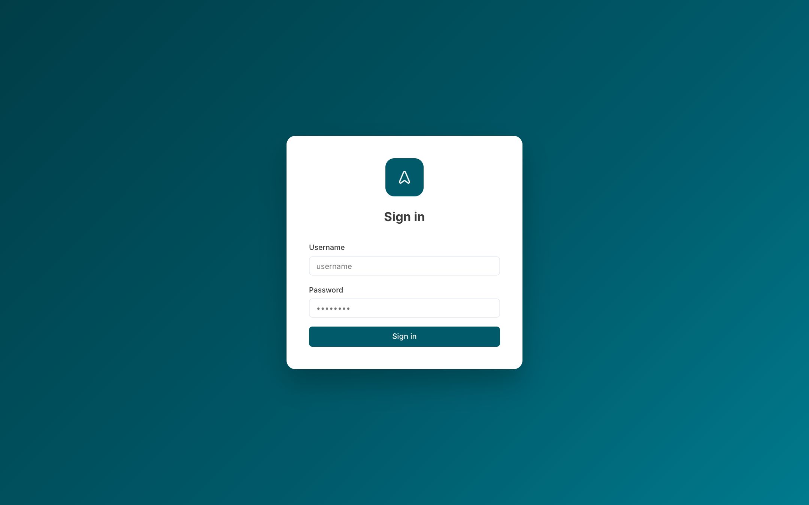
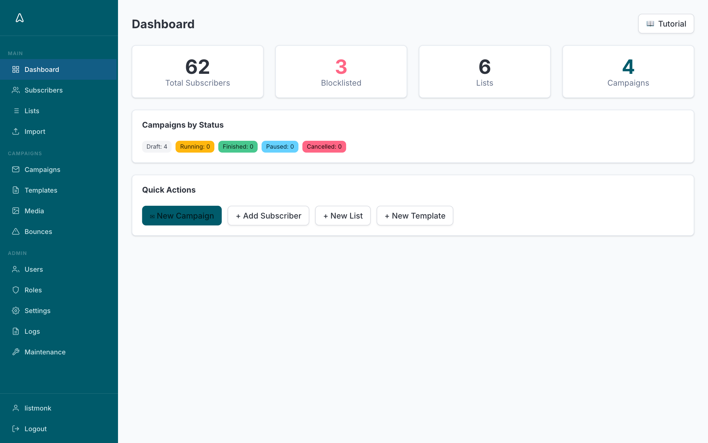
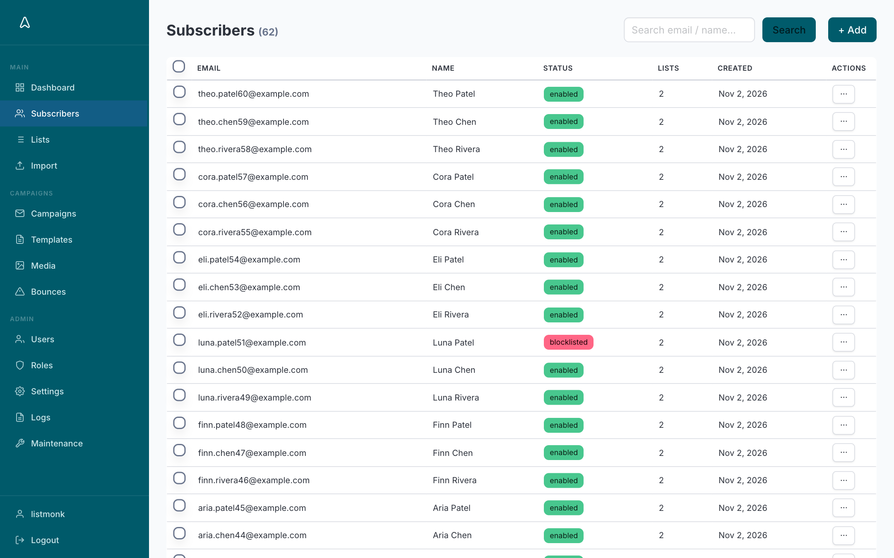
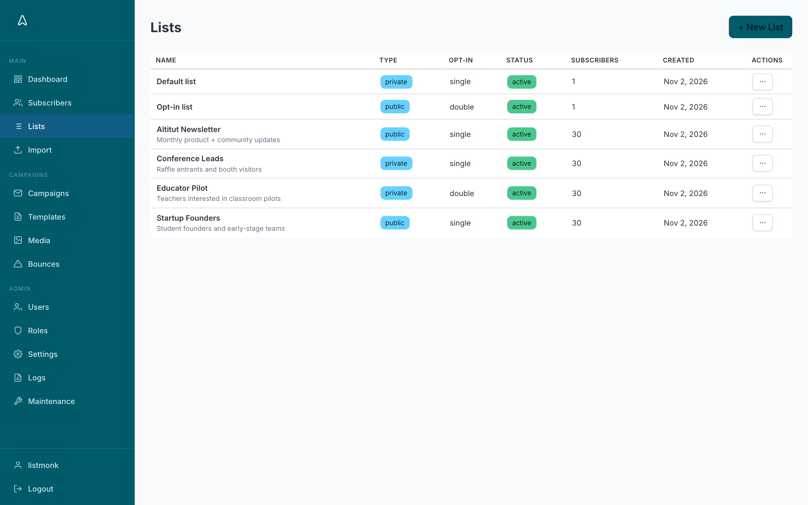
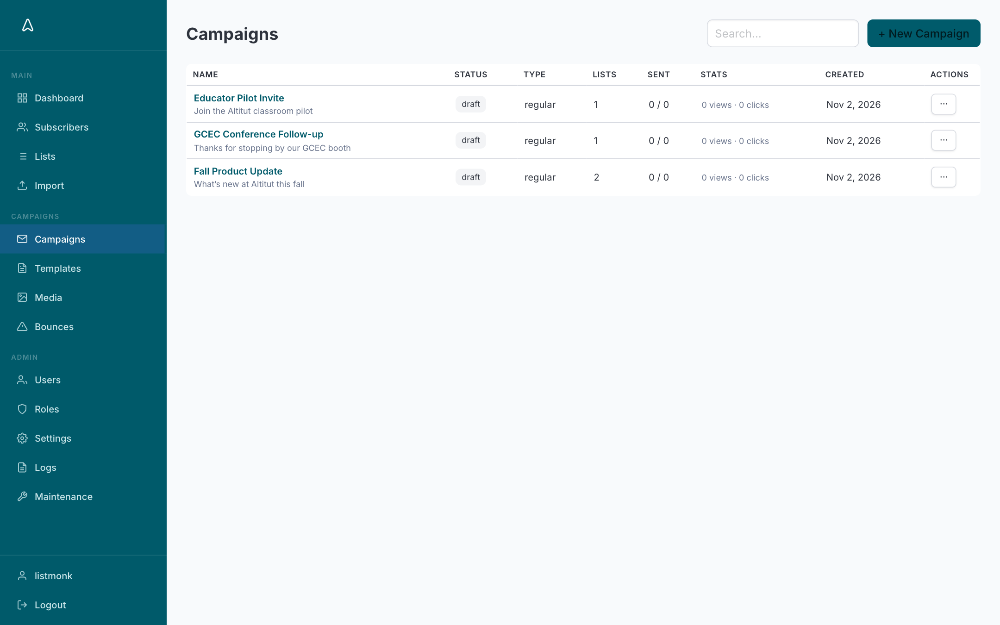
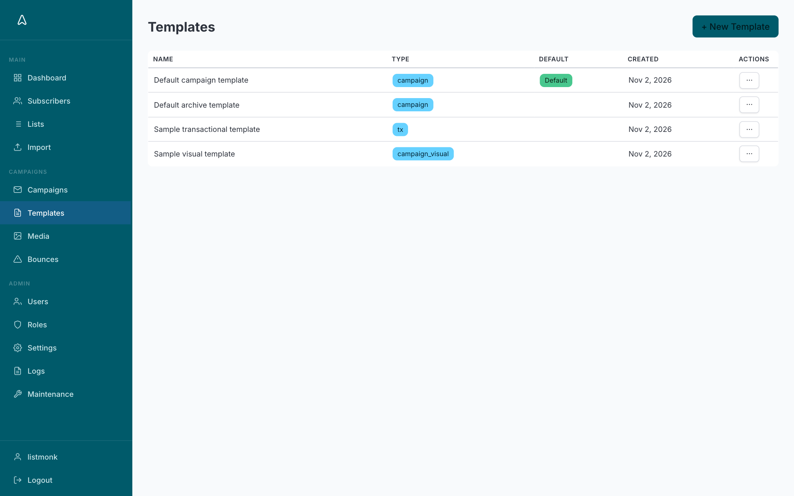
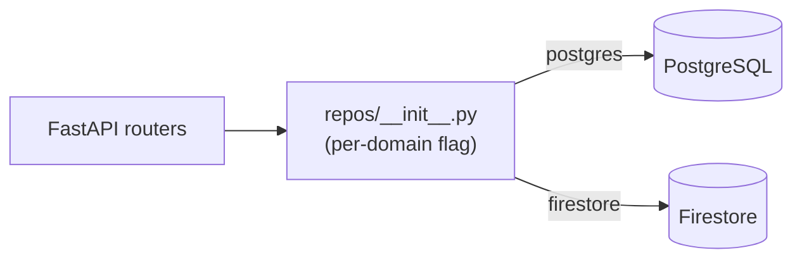

# Altitut CRM

A self-hosted newsletter, mailing-list, and subscriber CRM for Altitut. It began as a
fork of [listmonk](https://listmonk.app) and has since been re-platformed: the Go backend
was ported to **Python / FastAPI**, the frontend was rebuilt in **Vue 3**, and the whole
admin UI was rebranded and redesigned to the Altitut identity.

> The original Go source (`cmd/`, `internal/`, `models/`, `*.go`) is kept in the tree for
> reference but is **not** the app that runs. The live app is `backend/` + `frontend/`.

**Highlights**

- Python/FastAPI backend (async SQLAlchemy, Pydantic v2) serving a Vue 3 + TypeScript admin UI.
- Incremental **Postgres → Firestore migration** behind a repository layer with per-domain
  feature flags ([details](#postgres--firestore-migration-in-progress)).
- Quality gates all passing: backend `pytest` (21 tests), `ruff` and `mypy --strict`; frontend
  ESLint and `vue-tsc`; and a 28-spec headless **Playwright E2E suite**.
- One-command local run with Docker Compose.

Based on [listmonk](https://github.com/knadh/listmonk) by Kailash Nadh and contributors
(AGPL-3.0) — see [Credits & license](#credits--license).

---

## Screenshots

The rebranded admin UI (Vue 3 + Oruga/Bulma). All data shown is fake demo data.

| | |
| --- | --- |
|  |  |
|  |  |
|  |  |

---

## Team & contributions

Built by a three-person team for [Altitut](https://altitut.ai):

| Who | Role |
| --- | ---- |
| **Desiree Bishnoi** ([@dbrawla](https://github.com/dbrawla)) | Team lead. Altitut rebrand; admin-UI bug fixes; the **Postgres → Firestore data-layer migration** (see below). |
| **Merlin** ([@Merlin-2-5](https://github.com/Merlin-2-5)) | Python/FastAPI port of the Go backend, Vue 3 frontend, campaign send engine, headless E2E suite. |
| **Hongyang** | UI/UX design. |

Lu Sun and An Yan also contributed newsletter branding/templates and fixes on the Altitut side.

### Postgres → Firestore migration (in progress)

The data layer is moving from PostgreSQL to Firestore behind a **repository abstraction**
(`backend/app/repos/`), so routers talk to repos rather than SQL. Each domain has a Postgres
and a Firestore implementation behind a common `Protocol`, selected per domain by a config
flag (`repo_backend_*` in `backend/app/config.py`, default `postgres`). That makes cutover
incremental and reversible: flipping a domain is a config change, not a router rewrite.



Work done so far:

- Repos for **media, settings, sessions, roles, users, lists and subscribers**, wired into
  the auth, users, lists, media and subscriber routers. The subscriber repo (CRUD, list
  membership, **distributed counters** for high-write counts) is the largest.
- Password hashing moved off Postgres `pgcrypto` to **bcrypt** (`backend/app/passwords.py`).
- One-off **migration scripts** per domain in `backend/scripts/migrate_*_to_firestore.py`.
- Unit tests for the manager layer (`backend/test_manager.py`).

Campaigns, templates and bounces are still on Postgres, so the stack below is a hybrid.
Firestore needs a service-account key (`backend/firebase-credentials.json`, gitignored —
never commit it).

---

## Stack

| Layer      | Tech |
| ---------- | ---- |
| Backend    | Python 3.12, FastAPI, SQLAlchemy 2 (async) + asyncpg, Alembic, Pydantic v2, arq (background jobs), aiosmtplib |
| Frontend   | Vue 3 (`<script setup>`), TypeScript, Vite, Pinia, vue-router 4, Oruga UI 0.13 + `@oruga-ui/theme-bulma` 0.9 on Bulma 1.0, Chart.js, CodeMirror 6, TinyMCE |
| Database   | PostgreSQL 17 (default); Firestore for migrated domains |
| Packaging  | Docker Compose (backend image also builds & serves the compiled frontend) |

Brand: Altitut teal `#005A6A` (`hsl(189,100%,21%)`), Inter typeface, logo at
`frontend/src/assets/logo.svg`.

---

## Run it locally (Docker — recommended)

The backend image builds the Vue frontend and serves it, so one command brings up the
whole app plus Postgres.

```bash
docker compose up -d --build      # build + start backend and db
# open http://localhost:9000/admin
```

Default admin credentials are seeded on first start: **`listmonk` / `listmonk`**
(override with `LISTMONK_ADMIN_USER` / `LISTMONK_ADMIN_PASSWORD`). Change them for anything
that isn't local.

```bash
docker compose logs -f backend    # tail logs
docker compose down               # stop (keeps the db volume)
docker compose down -v            # stop and wipe the db
```

After editing frontend or backend code, rebuild: `docker compose up -d --build`.

## Run it locally (without Docker)

You need Python 3.12+, Node 18+, and a running Postgres 17.

```bash
# Backend
cd backend
pip install -e ".[dev]"
# point it at your DB via env vars (see backend/app/config.py): DB_HOST, DB_PORT,
# DB_USER, DB_PASSWORD, DB_NAME, ADMIN_USERNAME, ADMIN_PASSWORD
uvicorn app.main:app --host 0.0.0.0 --port 9000 --reload

# Frontend (separate terminal) — Vite dev server with hot reload
cd frontend
npm install
npm run dev
```

---

## Tests

```bash
# Backend: pytest + ruff + mypy --strict, run inside the running container
powershell -File scripts/backend-checks.ps1
# ...or directly, with the dev extras installed: pip install -e ".[dev]"
cd backend && pytest && ruff check app && mypy --strict app

# Frontend lint + types
cd frontend && npm run lint && npm run type-check

# End-to-end, headless, against a running stack
docker compose up -d --build
cd e2e && npm install && npm test
```

The E2E suite drives the admin UI in headless Chrome via Playwright. It uses the
locally installed Chrome (`channel: 'chrome'`) so there is no browser download.
Override the target with `BASE_URL`, and the login with `ADMIN_USER` /
`ADMIN_PASSWORD`.

---

## Project layout

```
backend/
  app/
    main.py            FastAPI app + startup (seeds admin, mounts frontend dist)
    config.py          Pydantic Settings — all env vars live here
    db.py auth.py ...   core modules (manager, importer, bouncescan, captcha, notifs…)
    routers/           one file per API area: subscribers, lists, campaigns, templates,
                       media, users, bounces, tx, import_, maintenance, archive,
                       public, admin, auth
  Dockerfile.backend   multi-stage: builds frontend, then the Python image
  pyproject.toml       deps + ruff/mypy config
frontend/
  src/views/           one Vue view per admin page (Dashboard, Subscribers, Campaigns,
                       CampaignEditor, Lists, Templates, Media, Users, Roles, Bounces,
                       Import, Logs, Maintenance, Settings, Profile, Layout, Login)
  src/assets/
    main.css           custom shell design system (.sidebar-*, tokens)
    brand.css          Altitut retint of Bulma + UI polish (loaded LAST)
  src/main.ts          app bootstrap — Pinia, router, Oruga (see comments; load order matters)
docker-compose.yml     backend + db services
```

---

## Tooling for contributors (Claude Code)

This project is built with the help of **Claude Code**. Some Claude Code skills/plugins were
used to build and maintain the app — teammates should install them so everyone works with the
same tooling. See **[CLAUDE.md](CLAUDE.md)** for the full architecture guide and the exact
install commands.

---

## Credits & license

This project is a fork of [listmonk](https://github.com/knadh/listmonk) by Kailash Nadh and
its contributors; the original Go source is kept in the tree for reference. It inherits
listmonk's **AGPL v3** license (see `LICENSE`).

The Altitut re-platforming (FastAPI backend, Vue 3 frontend, Firestore migration, rebrand)
was done by the team listed under [Team & contributions](#team--contributions).
